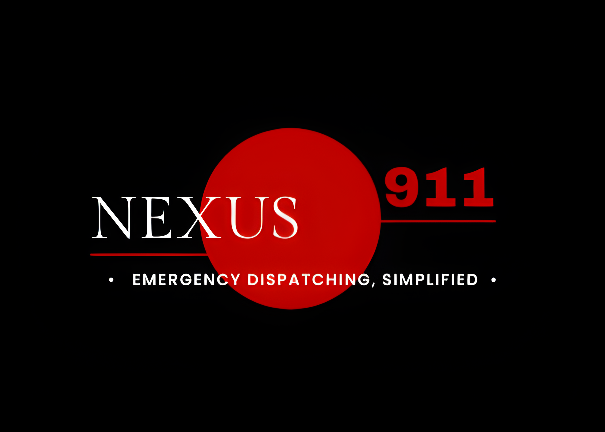

# Nexus911 frontend design

Design package for the Nexus911 frontend: a clickable mock of the four screens, the style guide that explains every design choice, and the instructions to build it in the real app.

**Flow:** Landing → Sign in (or continue as guest) → Onboarding → Dashboard
**Look:** the Nexus911 logo palette (black, crimson `#C00000`, white), with BizzNex's typography and screen patterns.

## What's in this folder

| File | What it is | Open with |
|---|---|---|
| [`nexus911-mock.html`](nexus911-mock.html) | Clickable mock of all four screens with sample data from the highway-accident scenario | Any browser |
| [`STYLE_GUIDE.html`](STYLE_GUIDE.html) | The style guide: colours, type, logo motifs, layout, components, motion, accessibility, writing, and why each choice was made | Any browser |
| [`FRONTEND_BUILD_PROMPT.md`](FRONTEND_BUILD_PROMPT.md) | Step-by-step build instructions, written to paste into a Claude Code session | Text editor or GitHub |
| [`PORT_PLAN.md`](PORT_PLAN.md) | The audit behind the build: font table, onboarding anatomy, step copy, decisions | Text editor or GitHub |
| [`Nexus911.png`](Nexus911.png) | The logo the colours were sampled from | Image viewer |

## Viewing the mock

1. Download or clone this folder.
2. Double-click `nexus911-mock.html`. It opens in your browser; no install or server needed.
3. Click through the flow, or use the bar at the top to jump between screens.

Add one of these to the end of the file's address to open a screen directly:

| Ending | Screen |
|---|---|
| `#landing` | 01 · Landing page |
| `#signin` | 02 · Sign in |
| `#welcome` | 03 · Onboarding |
| `#dashboard` | 04 · Dashboard |

Things to try: clear the name field and press Continue (validation); continue as guest (no greeting); on onboarding step 3, press **Preview: server down**; press Escape during onboarding (skips it); use **Replay intro** and **Sign out** on the dashboard.

### Good to know

- **Fonts need internet.** Fraunces, IBM Plex Sans and IBM Plex Mono load from Google Fonts. Offline, the pages fall back to Georgia and system fonts; layout and colours stay the same.
- **It's a mock.** Nothing connects to a backend, and the dashboard screen is an approximation of the real Nexus911 dashboard. In the real build, the dashboard keeps its own layout and only gains the palette and three header controls (name or Guest, Replay intro, Sign out).
- **It remembers the name you enter** in your own browser (local storage). Nothing is sent anywhere.
- GitHub shows the HTML files as code. Download them, or serve the folder with GitHub Pages, to see them as pages.

## Building it in the real app

The build happens in the [Nexus911 repo](https://github.com/cheruvathoorshajd/Nexus911) (React + Vite + TypeScript + Tailwind v4 in `frontend/`, FastAPI backend).

1. Copy this whole folder into the Nexus911 repo as `design/`.
2. Clone [BizzNex](https://github.com/cheruvathoorshajd/BizzNex) next to the repo, as `../BizzNex`. It's the reference for the fonts and screen patterns.
3. Open `design/FRONTEND_BUILD_PROMPT.md`, set `SIGN_IN_MODE` at the top, and paste everything below its line into a Claude Code session started in the Nexus911 repo root.

| `SIGN_IN_MODE` | Sign-in behaviour | Backend change |
|---|---|---|
| `A` | Guest only; the sign-in form is shown disabled | None |
| `B` (chosen) | Name only, kept in the browser, clearly labelled; plus guest | None |
| `C` | Real accounts: register, log in, hashed passwords, expiring tokens; plus guest | Adds auth routes |

Guests get every feature in all three modes.

The prompt works in steps, with a local commit after each: fonts, colours, session, routing, landing, sign in, onboarding, dashboard wiring, lint setup, and a verification checklist. It never pushes.

## Key decisions

- **One red.** Crimson `#C00000` comes from the logo and is the only red. It's 3.24:1 on black, so it's used for fills (with white text, 6.48:1), icons, dots, rules and large type, and never for small text.
- **Critical shares the brand red,** and always also shows the word "Critical" and a red stripe, so it never relies on colour alone.
- **Three voices:** Fraunces serif for headlines, IBM Plex Sans for body text and controls, IBM Plex Mono for labels, numbers and states.
- **No fake security.** The prototype has no accounts, so sign-in asks only for a name and says so; there's no password field that wouldn't be checked.
- **Honest about the prototype.** Simulated callers and no real dispatch are stated on the landing page, at sign-in and in onboarding.

The full reasoning is in `STYLE_GUIDE.html`.

## Open decisions

- The logo's real typefaces (Fraunces and Plex are stand-ins until the names are confirmed).
- Whether Critical should get its own brighter red.
- Whether to embed the fonts so the mock works fully offline.

## Sources

- **Nexus911 logo** (`Nexus911.png`): all colours and logo motifs.
- **BizzNex** (`apps/web`): fonts, type scale, and the landing, sign-in and onboarding patterns.
- **Nexus911 README and `simulation/scenarios.py`**: landing content, comparison table, limitations, and the highway-accident demo data.
